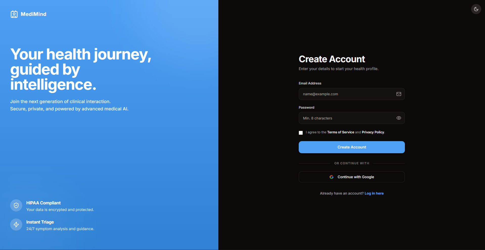
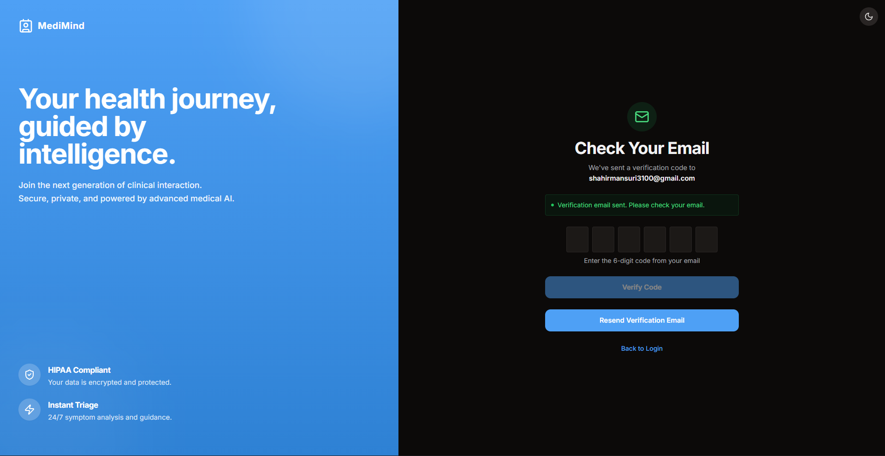
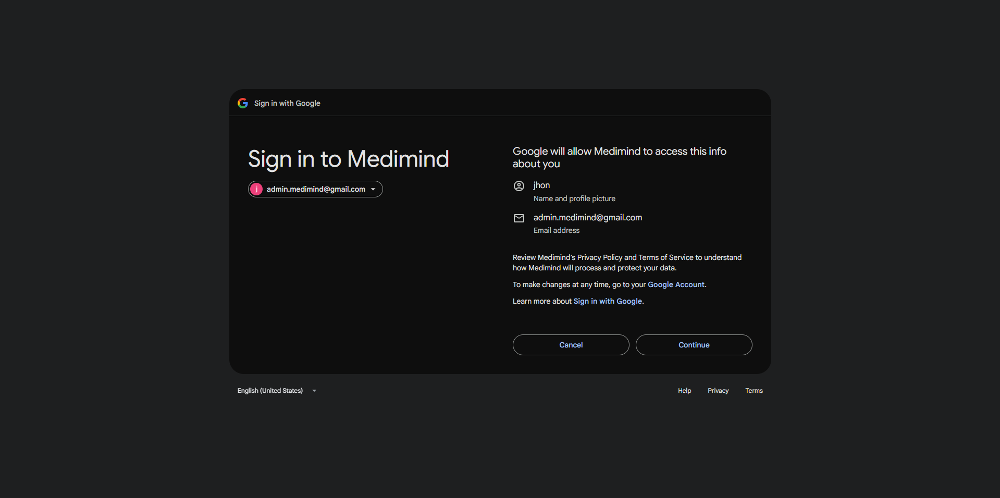
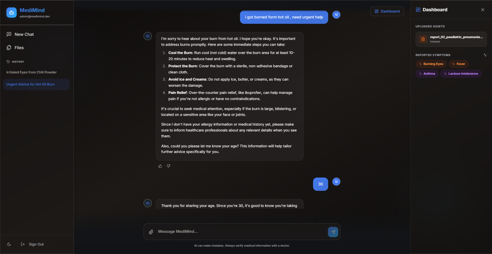
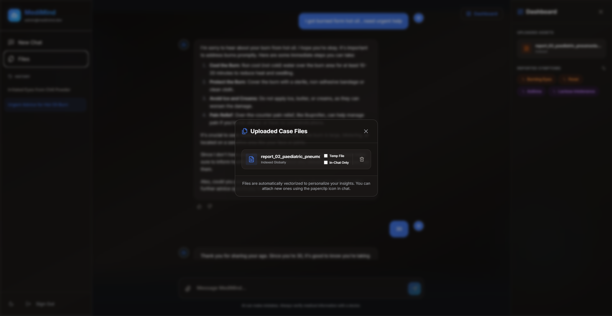

# MediMind  - Personalized AI Medical Assistant

MediMind is a state-of-the-art AI medical assistant designed to provide personalized, history-aware healthcare information. By combining long-term memory, authoritative medical knowledge bases, and user-uploaded clinical data, MediMind offers a unified health companion that grows with you.

---

## Screenshots











---

##  Key Features

- **Personalized Patient Memory**: Utilizes **Mem0** to maintain a persistent health profile, including allergies, chronic conditions, and past medications, ensuring every response is contextually relevant.
- **Authoritative Medical RAG**: Connects to a high-fidelity medical knowledge base to retrieve factual information from verified healthcare references.
- **Patient Case Analysis**: Support for medical document uploads (PDF). MediMind indexes and analyzes your case files to provide specific insights based on your clinical records.
- **Secure File Scoping**: Advanced document management allowing files to be scoped as **Temporary** (deleted after session) or **In-Chat Only** (restricted to a specific conversation thread).
- **Persistent Chat History**: Scalable conversation management powered by Supabase, enabling users to revisit, rename, and manage past medical consultations.
- **Live voice chat** with spoken replies and captions powered by `gemini-3.8-live`.
- **Interactive Symptom Tracking**: Dynamically extracts and visualizes reported symptoms and conditions for easy monitoring.
- **Global Feedback Intelligence**: Implements a global feedback loop where positive and negative interactions improve the AI's empathy and accuracy for the entire community.
- **Responsive Experience**: A premium, glassmorphism-inspired UI designed to work seamlessly on Mobile, Tablet, and Desktop resolutions.

---

## Tech Stack

### AI / Machine Learning
- **Model**: Gemma 4 31B on Ollama Cloud through LangChain `ChatOllama`.
- **Embeddings**: Gemini Embedding 2 at 1,536 dimensions for documents, reference material, and Mem0.
- **Memory**: Mem0 for user-level history persistence and cross-session retrieval.
- **Vector Search**: Pinecone (Reference Knowledge) & Supabase pgvector (Patient Files).

### Backend
- **Framework**: FastAPI (Python 3.13+)
- **Database**: Supabase (PostgreSQL) for user data and chat history.
- **Authentication**: JWT-based secure authentication with Supabase integration.

### Frontend
- **Framework**: React 18 + Vite
- **Styling**: Tailwind CSS with custom animations.
- **Icons**: Lucide-React.
- **UI Components**: Radix UI & Shadcn-inspired minimalist design.

---

## Getting Started

### Prerequisites
- Node.js (v18+)
- Python (3.13+)
- Supabase Account
- Ollama Cloud API key for generation
- Gemini API key for embeddings and live voice chat
- Pinecone Account

### Backend Setup
1. From the project root, install the locked dependencies using **uv**:
   ```bash
   uv sync --locked
   ```
2. Configure the environment variables below. If upgrading an existing instance, re-embed its stored vectors before starting the new backend.
3. Start the server:
   ```bash
   uv run --locked uvicorn backend.main:app --reload
   ```

### Frontend Setup
1. Navigate to the frontend directory:
   ```bash
   cd frontend
   ```
2. Install dependencies:
   ```bash
   npm install
   ```
3. Start the development server:
   ```bash
   npm run dev
   ```

---

## Environment Variables

Create a `.env` file in the project root and generate an Ollama Cloud API key. [Ollama API keys](https://ollama.com/settings/keys)

The hosted API uses `gemma4:31b` for Gemma 4 31B Cloud. [Ollama Cloud setup](https://docs.ollama.com/cloud)

Generate a `GEMINI_API_KEY` for embedding requests and live voice chat. [Gemini API keys](https://aistudio.google.com/apikey)

```env
# LLM generation via Ollama Cloud
OLLAMA_API_KEY=your_ollama_api_key
OLLAMA_MODEL=gemma4:31b

# Gemini embeddings and live voice chat
GEMINI_API_KEY=your_gemini_api_key
JWT_SECRET_KEY=your_random_jwt_signing_secret

# Database (Supabase)
SUPABASE_URL=your_supabase_url
SUPABASE_ANON_KEY=your_supabase_anon_key
DATABASE_URL=your_supabase_postgresql_connection_string

# Vector Search (Pinecone)
PINECONE_API_KEY=your_pinecone_key
PINECONE_INDEX_NAME=your_index_name
```

### Live voice chat

Set `JWT_SECRET_KEY` to a random secret of at least 32 bytes. Sign in, select **Start voice chat** in the composer, and grant microphone access on HTTPS or localhost. If you were signed in before voice chat was added, sign out and back in once to refresh your session.

MediMind issues a single-use session credential so the browser can stream audio directly to Gemini. Voice sessions use the context shared within that session. When a voice chat ends, MediMind opens the saved text transcript and adds it to History. Voice history stores captions through the backend's `DATABASE_URL` connection, which needs permission to create the private `medimind_voice` schema on the first save. [Gemini Live API](https://ai.google.dev/gemini-api/docs/live-api)

### Migrating existing embeddings

OpenAI and Gemini vectors use different embedding spaces. Existing installations must regenerate vectors from the stored source text. [Gemini Embedding 2 documentation](https://ai.google.dev/gemini-api/docs/embeddings)

Back up Supabase and stop the backend and any indexing jobs. From the project root, use the same `DATABASE_URL` and Pinecone index as the backend and run:

```bash
uv run --locked -m scripts.reembed_vectors postgres
uv run --locked -m scripts.reembed_vectors pinecone
```

The Postgres command replaces vectors in one transaction and keeps document text, memory metadata, and row IDs. The Pinecone command copies records from the default namespace of a serverless index into `gemini-embedding-2`. If you have the source PDFs, you can also rebuild Pinecone with `uv run --locked scripts/index_kb.py` after putting them in `knowledge_base/`. Start the new backend after the required migrations succeed.

---

## Disclaimer
**MediMind is an AI assistant and should not be used as a replacement for professional medical advice, diagnosis, or treatment. Always seek the advice of your physician or other qualified health provider with any questions you may have regarding a medical condition.**

---

## License
This project is licensed under the [MIT License](LICENSE).
